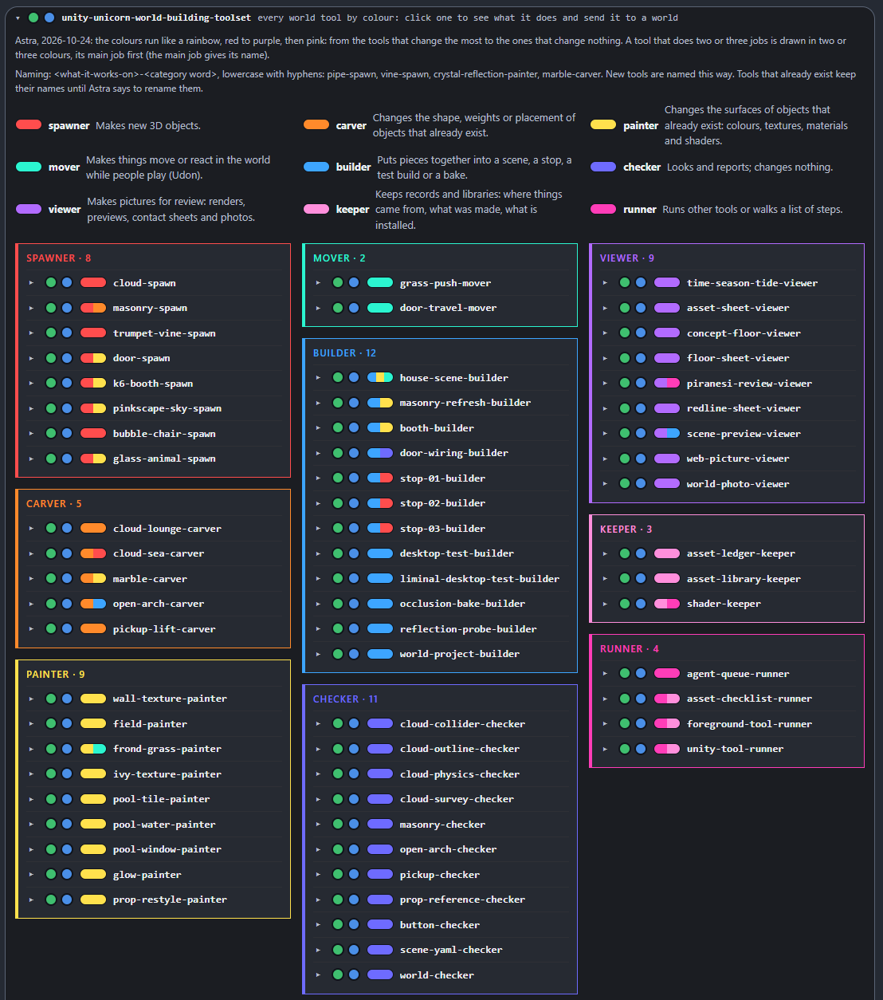

# Unity Unicorn

*By Astra.* A pet that keeps Astra's Unity and VRChat work in one place: 85 world and avatar tools, avatar plans,
scene ideas, build tasks and release checks.

## Unity Stable

Unity Unicorn's program page. Every world tool is listed once, coloured by what it does: red to purple, then pink,
from the tools that change the most to the ones that change nothing.

**[⬇ Download Unity Unicorn (ZIP)](https://github.com/findastra/unity-unicorn/archive/refs/heads/main.zip)**, then open
`unity-unicorn-20261008.html` in your browser.

**Needs:** a browser for the page; Unity 2022.3 and the VRChat Creator Companion for the tools.

## How to run

Open [unity-unicorn-20261008.html](unity-unicorn-20261008.html) directly in a modern browser. No install, server, account, or network connection is needed.

## What works

- Add and edit task records with purpose-specific fields.
- Search, filter by status, advance a record, and delete with undo.
- Keep entries in this browser's local storage.
- Export a private JSON backup or Markdown worklist.
- Choose among all nine pet moods.
- Search a library of Unity, cloud-generation, inspection and build tools.
- Import a private catalog with local paths and dated execution evidence.
- Import masonry-audit reports and usage receipts; inspect findings, metrics and limitations.
- Track the last completed use in America/Denver, with **Unknown** when evidence is missing.
- Copy command templates and export a private tool-library backup.

An optional ignored local sidecar can supply the installed desktop app with private inventory and execution dates. Run tools locally and import their reports. The browser does not connect to Unity or execute commands. See [the tool-library contracts and workflow](docs/tool-library-20261011.md).

## Skill book

What Unity Unicorn has learned about avatar and world work, sorted by category, is in [docs/skills-20261009.md](docs/skills-20261009.md). Add new skills there and log each session.

## Avatar tracker and plans

- [docs/avatar-tracker-20261009.md](docs/avatar-tracker-20261009.md): which avatars are uploaded to which VRChat account, with PC, Quest, impostor, fallback and opti coverage, plus the upload to-do list.
- [docs/avatar-plans-20261009.md](docs/avatar-plans-20261009.md): planned edits gathered from the edit log in each avatar's folder.

The tracker is updated by hand or by a routine scan. The app does not log in to VRChat itself.

## Asset ledger (design, 2026-10-14)

How Unity Unicorn acquires, audits, handles and credits every asset in Astra's worlds and avatars: a row for every
asset before it ships, paid assets never in a repo, research-only and unclear assets kept as private placeholders, and
credits generated per world. Design: [docs/asset-ledger-20261014.md](docs/asset-ledger-20261014.md); worked examples for
Astra's Infinite Pole (all cleared) and Piranesi House (blocked for public upload until its stand-in scans are replaced):
[docs/asset-ledger-example-20261014.json](docs/asset-ledger-example-20261014.json). Not built into the web app yet.

## Data and limits

Records are stored only in the browser where you enter them. Clearing site data can remove them; export backups. Exported records can contain personal information and must stay outside this source repository. The page does not send entries to a server. The pet's mood is a display choice. Loading the app, copying a command or importing a catalog never creates a new use timestamp. Imported report times are execution evidence supplied by the tool; the browser does not independently verify them. Existing planning-desk data is preserved in its original storage key.

## Source version

Version `0.2.0-20261011`, source tag [`v0.2.0-20261011`](https://github.com/findastra/unity-unicorn/tree/v0.2.0-20261011). Source publication and release verification are recorded separately from local feature checks in [the dated publication record](docs/publications-20261011.md). Previous revisions are recorded in docs/publications-20261009.md.

## Credits

Made by Astra. Interface prepared with Codex (GPT-6), 2026-10-08. The pet artwork is copied from Astra's PetOS.

Tool library and report imports prepared with Codex (GPT-6), 2026-10-11. The square pet-well layout is preserved from the Cage's 2026-10-09 revision.

Desktop hub sync, 2026-10-11: the Unity tool-library interface now accepts local catalog/verification imports, preserves original execution dates, and exports private backups. Local seed files are not published.

## Open arches and dated tools (0.3.0-20261011)

The library includes 31 dated tool definitions with short summaries below each name, including the no-windows auditor and its Unity scene-refresh workflow. Known tool descriptions update without changing recorded use dates. The naming rule is documented as `my-preferred-nomenclature` in the skill book.

See [publication and validation](docs/open-arches-publication-20261011.md). Source: [v0.3.0-20261011](https://github.com/findastra/unity-unicorn/tree/v0.3.0-20261011). The pet remains a local catalog and report viewer; it does not launch Unity commands itself.

## Marble carver and vine bloomer (2026-10-11)

Two world-building tools for the Piranesi House, with step scripts under `scripts/`:

- **marble-carver**: statues that look like real carved marble, starting from scans of real museum statues. They're adapted and weathered in Blender, baked, and brought into Unity. Guide: [docs/marble-carver-20261011.md](docs/marble-carver-20261011.md).
- **vine-bloomer**: ivy over every roof and most of every outer wall, using a Blender-rendered ivy mantle from scanned leaves plus 3D leaf curtains at the edges. Guide: [docs/vine-bloomer-20261011.md](docs/vine-bloomer-20261011.md).

Added with Claude Opus 5.5 (`claude-opus-5-5`), 2026-10-11.

## Neck blender (2026-10-11)

- **neck-blender**: hides the line where a separate head mesh meets the body. It paints the face's skin colour into a copy of the body texture around the neck and fades matcap and rim out at the line on both materials, all weighted from the real geometry in Blender, with backups. Guide: [docs/neck-blender-20261011.md](docs/neck-blender-20261011.md).
- **face-transfer**: keeps a private log of each avatar's face tracking build (which VRCFT OSC standard its parameters use, which module drives them, which blendshapes the face FBX has) and moves a face tracking module to another avatar with its dependencies, after checking the target has every blendshape it animates. Guide: [docs/face-transfer-20261011.md](docs/face-transfer-20261011.md).

Added with Claude Opus 5.5 (`claude-opus-5-5`), 2026-10-11.

## Framework panels (0.4.0-20261018)

The top of the page now follows [the Pet Program Framework](https://github.com/findastra/astras-pet-os/blob/main/PET-PROGRAM-FRAMEWORK.md), section 3 (Astra's sketch of 2026-10-18): the cyberhome, the **Unity Stable** title with its version, the quick summary and status line, the four stacked L1 to L4 panels, session notes that save to the backlog, the nine emotions, clicker training, the unified footer and the chat button. Every panel collapses on a phone, and every item has its two paired lights (ON/OFF and maintenance).

The L1 panel lists all 32 tools on `main` and the 21 that are not merged yet (PR #1's avatar effect tools, including **sparkle-strapper** and **fan-fitter**, PR #3, and the asset ledger), each marked "not merged". **Added tonight** lets you add a tool or program as you make it; it stays in this browser and goes into the backlog.

Limits: the lights, the backlog and added items are saved in this browser only, because the Farm's core switch is not built. The seat, the chat bot, keys, grants and the weekly backlog run are shown as planned. Added with Claude Opus 5.5 (`claude-opus-5-5`), 2026-10-18.

## world-spawn-tool (2026-10-18)

- **world-spawn-tool**: spawns a new VRChat world. First a public GitHub repo, then a link with a cute one-line summary in the Findastra profile README (by pull request), then the Unity project skeleton. It started in Liminal Doors (draft findastra/liminal-doors#1) and moved here, its own pet program, on 2026-10-18. Guide: [docs/world-spawn-tool-20261018.md](docs/world-spawn-tool-20261018.md); code and tests in `scripts/world-spawn-tool/`.
- Limit: its skeleton step still copies from a reference world. Astra's rule since 2026-10-18 is that new worlds start fresh from VCC's World template, so change that step before the next world.

`pet.json` now has the framework's `intelligence_levels` block: every tool in L1 (on `main`, and not merged with its pull request), tricks in L2, harness skills in L3, and no item in two panels. Added with Claude Opus 5.5 (`claude-opus-5-5`), 2026-10-18.

## Labels as in Astra's sketch (0.4.1-20261018)

Every panel's label now sits on its top border, the way Astra drew it: the cyberhome, the quick summary, the L1 to L4 panels, session notes, emotions, clicker training, the unified footer and the chat. The cyberhome has its own label (`unity-unicorn-cyberhome`) and the title has none. The quick summary uses the sketch's words: a dashboard for your world and avatar programs and the tools and tricks that manage them, made to preserve the authenticity, creativity and provenance of all artists' work. The moods show the sketch's names (awake, sleepy), and the chat button is the sketch's arrow in a circle. The L1 panel lists all 34 tools on `main` and the 21 not merged. Added with Claude Opus 5.5 (`claude-opus-5-5`), 2026-10-18.

## Panels, not modules (0.4.2-20261019)

The bordered, collapsible boxes on the page are **panels** (Astra, 2026-10-19): to a developer a module is a file of code, and a box on a dashboard page is a panel ([PET-PROGRAM-FRAMEWORK.md](https://github.com/findastra/astras-pet-os/blob/main/PET-PROGRAM-FRAMEWORK.md), section 1). The four level panels are now labelled `unity-unicorn-L1-panel` to `unity-unicorn-L4-panel`, and the page's own names follow (`uu-panels`, `uu-panel`). Lights you saved on the old `-module` labels carry over to the new ones; the browser storage key keeps its name so nothing saved is lost. The face tracking modules, masonry mesh modules and Python modules elsewhere in this repo are real modules and keep the word. `test/panels-test-20261019.mjs` fails if a page box is called a module again. Changed with Claude Opus 5.5 (`claude-opus-5-5`), 2026-10-19.

## Matcap palette (0.4.3-20261019)

A new panel, **unity-unicorn-matcap-panel**: every matcap as a round pan in a graphite compact, like a makeup palette. Pick one to see it big on a sphere and on a ring you can turn, try a hue and tint, favourite it, or save it as a PNG for Unity. Its 54 matcaps (Liminal, Metal, Candy, Holo, Glass, Toon, Neon, Soft, Sparkle) are drawn from math, so they are yours to use anywhere; **Load my matcaps** shows your own files too, in that tab only.

- **matcap-palette** (Unity): Tools › Unity Unicorn › matcap-palette shows every matcap in a project the same way and puts the one you pick on a Poiyomi or lilToon material's matcap slot, with Undo and a usage receipt. Code: `scripts/unity-editor/matcap-palette-20261019.cs`.
- PNGs: `node scripts/matcap-palette/make-matcaps-20261019.mjs <out-folder>` writes the 54 from the page's own recipes.
- Guide: [docs/matcap-palette-20261019.md](docs/matcap-palette-20261019.md). Made with Claude Opus 5.5 (`claude-opus-5-5`), 2026-10-19.

## Menu map (0.4.4-20261019)

A new panel, **unity-unicorn-menu-map-panel**: an avatar's real radial menu, the way VRChat shows it, after VRCFury and Modular Avatar have built it. Click a wedge to open a submenu or switch a toggle; the middle is Back. Beside it, the **parameter budget**: synced bits used out of 256, the total before VRCFury's compressor, and what each add-on costs (each top menu, the compressor's own slots, and parameters the menu does not show). **Load a menu map** keeps your file in that tab only; **Try the sample** shows a made-up avatar.

- **menu-map** (Unity): select the avatar and run Tools › Unity Unicorn › menu-map. It builds a disposable test copy (the SDK build step an upload runs), writes `UnityUnicornReports/menu-map-<avatar>-<time>.json` with every menu page, control, parameter and icon (PNG), deletes the copy and leaves a usage receipt. The scene is never saved. Code: `scripts/unity-editor/menu-map-20261019.cs`.
- Sample: [docs/menu-map-sample-20261019.json](docs/menu-map-sample-20261019.json). Guide: [docs/menu-map-20261019.md](docs/menu-map-20261019.md). Made with Claude Opus 5.5 (`claude-opus-5-5`), 2026-10-19.

## vcc-package-manager and vrchat-avatar-upload are tricks to write (0.4.5-20261019)

Astra decided on 2026-10-19 that everything a pet program owns is a native program, a native tool (code that runs with no AI) or a native trick (a SKILL.md its AI follows) ([astras-pet-os PR #114](https://github.com/findastra/astras-pet-os/pull/114)). **vcc-package-manager** and **vrchat-avatar-upload** have no code, only written steps, so they are now tricks to write: `pet.json` moves them from `intelligence_levels.L1.tools` to `L2.tricks_to_write` with a note, and the page lists them in the L2 panel, not the L1 panel. The L1 panel now lists 34 tools on `main`, with matcap-palette and menu-map (0.4.3, 0.4.4).

Their catalog files, `tools/vcc-package-manager-20261011.json` and `tools/vrchat-avatar-upload-20261011.json`, stay, with `kind` set to `Trick to write`:

- The hub's System Map and its registry table (TOOLS-AND-TRICKS.md) cite them as the source of each trick.
- With the skill book (sections 2 and 4 of [docs/skills-20261009.md](docs/skills-20261009.md)), they are the written steps each SKILL.md will be written from.
- The tool library keeps their cards, so a real upload or package change can still be recorded with its evidence.
- The v0.3.0-20261011 release has them, and release tags never change.

When a trick is written as `skills/<name>/SKILL.md`, move it to `L2.tricks` and decide then whether its catalog card stays. `test/levels-match-page-test-20261019.mjs` checks that `pet.json` and the page's L1 and L2 lists agree, and that no item is both a tool and a trick. Changed with Claude Opus 5.5 (`claude-opus-5-5`), 2026-10-19.

## Asset creator, assets library and shaders shop (0.4.6-20261019)

Three Unity Stable tools Astra asked for on 2026-10-18 ("lets make this booth together and then publish those tools"). They were built and first used in Liminal Doors, and moved here unchanged on 2026-10-19. Each folder is laid out like a world project, so installing one is a single copy into the project's folder.

- **unity-asset-creator**: walks one world asset through a researched 12-step checklist (plan, provenance, scale and pivot, geometry, materials, textures, colliders, lighting, effects, prefab, review in the world, export). A failed check blocks its step, and steps 3, 7 and 11 need a person. It ends by exporting the version (package, previews, checksummed manifest) and opening a pull request to the library. Code: `scripts/unity-asset-creator/`. Guide: [docs/unity-asset-creator-20261019.md](docs/unity-asset-creator-20261019.md).
- **unity-assets-library**: the public database of finished assets and their versions, [findastra/unity-assets-library](https://github.com/findastra/unity-assets-library), indexed in `library.json`. Astra merges every version. Guide: [docs/unity-assets-library-20261019.md](docs/unity-assets-library-20261019.md).
- **shaders-shop**: installs shaders for worlds the way Creator Companion would, after showing the files, sources and licences, and records which shaders each world uses. It also stocks our own Unity Stable shaders. Code: `scripts/shaders-shop/`. Guide: [docs/shaders-shop-20261019.md](docs/shaders-shop-20261019.md).
- **The unity-asset-creator trick** ([skills/unity-asset-creator/SKILL.md](skills/unity-asset-creator/SKILL.md), L2): how an agent walks the checklist through the world's agent queue and publishes, and what it asks Astra first. In `pet.json` and on the page it is `unity-asset-creator-trick`, the id the hub gives it, because no item may be both a tool and a trick.

Limits: tested in one world (Liminal Doors) on two assets, the phone booth and stop 1's sky, both v1.0.0 in the library. The library has no licence yet. Liminal Doors keeps its incubating copy, so change the tools here first. Made with Claude Opus 5.5 (`claude-opus-5-5`), 2026-10-19.

## Avatar tools, world tools and vines with trumpet flowers (0.5.0-20261019)

Astra asked on 2026-10-19 for every tool we have built to be in a panel, for the page to be split into avatar tools and
world tools, for a panel of the sparkles used in the worlds, and for a new vine tool with trumpet flowers in colours she picks.

- **Two tabs below the L1 to L4 panels: Avatar tools and World tools.** Every tool is in exactly one panel:
  - 22 avatar tools: building and fitting, the matcap palette, the menu map, sparkles, effects and records;
  - 63 world tools: for every world, then made for Piranesi House, Astra's Infinite Pole and Liminal Doors, including the
    26 still in the worlds' own repos.

  Panels stay closed until you click them, and the page remembers what you opened. Guide:
  [docs/avatar-and-world-tools-20261019.md](docs/avatar-and-world-tools-20261019.md).
- **World sparkle tools** (`unity-unicorn-world-sparkles-panel`): 27 sparkles from the three worlds, each with its source.
  - Liminal Doors: the sparkle sky, sparkles over the field, door motes and glitter halos, Glitter Paint, portal glitter,
    bubbles, motes and the booth swirl.
  - Astra's Infinite Pole: the glitter collection and controls, star dust, sparkle rain and the sparkle slurry.
  - Piranesi House: mica, motes and the Colossus's hand.

  The list is in [docs/world-sparkle-tools-20261019.json](docs/world-sparkle-tools-20261019.json).
- **vine-spawn-with-trumpet-flowers** (`unity-unicorn-vine-spawn-panel` and a Unity window), built on vine-bloomer.
  - Pick up to 10 flower colours as squares from a 30-colour palette, and pick the world: Piranesi House, Astra's Infinite
    Pole or Liminal Doors.
  - **Open in Unity** saves a job file to Downloads. The world's open Unity editor, with the tool installed, picks it up within
    2 seconds and opens the vine window with those colours. A web page can't start Unity itself.
  - In Unity, select walls, arches or railings and press Grow vines. Vines climb or hang, wrap round edges, and carry leaves,
    buds and five-lobed trumpets, with their own Unity Stable/Vine Bloom shader. One Undo takes them away.
  - Code: `scripts/unity-editor/vine-spawn-with-trumpet-flowers-20261019.cs` (install: copy it into the world's
    `Assets/UnityUnicorn/Editor/`). Guide: [docs/vine-spawn-with-trumpet-flowers-20261019.md](docs/vine-spawn-with-trumpet-flowers-20261019.md).
  - Fixed the same day, after its first real use in Astra's Infinite Pole:
    - An optional **Leaf glow** keeps stems and leaves green in a world lit mostly by glowing materials. It is 0 unless you
      turn it up, so worlds with a sun look as before; for Astra's Infinite Pole the page and the window offer Flower glow 1.5
      and Leaf glow 0.4.
    - Flower glow starts at 0.4.
    - The window opens in the middle of Unity, and its squares wrap to its width.
    - Vines start only where the object is open to the world, so they climb a phone kiosk's outside, not its inside glass.

Limits:

- The vine tool and its fixes were tested in a throwaway Unity 2022.3 project, including a job file the page made. Its
  first real use, in Astra's Infinite Pole (findastra/astras-infinite-pole PR #5), was before the fixes.
- The Liminal Doors tools and sparkles link to branch `claude/fresh-start-20261018` until liminal-doors PR #2 is merged.

Made with Claude Opus 5.5 (`claude-opus-5-5`), 2026-10-19.

## Assets we created (2026-10-19)

Two panels list every asset we made, never mixed (Astra, 2026-10-19): **unity-unicorn-avatar-assets-panel** at the end of the
Avatar tools tab and **unity-unicorn-world-assets-panel** at the end of the World tools tab, each by type: effects, outfits and accessories, props, shaders and
looks, rigs and face; buildings and props, skies, ground and plants, materials and shaders, effects. Each card shows a
preview, its version, its licence, where it was made and every world or avatar it is used in. The rows are
[docs/assets-we-created-20261019.json](docs/assets-we-created-20261019.json); one copy of each finished asset lives in
[findastra/unity-assets-library](https://github.com/findastra/unity-assets-library). First rows: the K6 phone booth
(Liminal Doors and Astra's Infinite Pole), stop 01's sunset sky and the CC0 pink payphone. No avatar assets are listed yet.

## Who made each tool (2026-10-19)

Astra: "we need to distinguish whether we made the tools or somebody else made the tools." The
**unity-unicorn-made-by-panel**, right after the L1 panel, lists every tool on the page under who made it: made by us
(Astra with Claude Opus 5.5 or OpenAI Codex (GPT-6), with the date and the project it was first made in) or made by others
(the programs and packages Unity Unicorn uses, each marked for avatars, worlds or both). "Made with" comes from the commit
that added the tool or a repo's credit line; "not recorded" means none names the assistant (Astra's Infinite Pole's first
builder scripts, 2026-09-12). The rows are [docs/made-by-20261019.json](docs/made-by-20261019.json), checked by
`test/made-by-test-20261019.mjs`. Every tool on the page is ours; nothing made by others is listed as a tool.

## Tool panels (0.5.1-20261019)

Astra, 2026-10-19: "I do want all of it to say tool panel instead of just panel". Every box on the page whose label ended in `-panel` now ends in `-tool-panel`: the four
level panels (`unity-unicorn-L1-tool-panel` to `unity-unicorn-L4-tool-panel`) and the 15 other tool panels: made-by, and
the Avatar tools and World tools sides (for example `unity-unicorn-matcap-tool-panel` and `unity-unicorn-avatar-assets-tool-panel`). The page's own
words follow: "Add to the L1 tool panel" and "Click a tool panel to open it".

- Lights you saved on the old `-panel` labels, or the older `-module` ones, carry over to the new labels, under the same
  browser storage key. The tabs and tool panels you had open stay open (they are saved by the box's id, which did not change).
- Code names stay: the `uu-panels` section, the `uu-panel` class and the chat panel. The Unity scripts keep their own words.
- `test/panels-test-20261019.mjs` fails if a page box label ends in `-panel` without `tool`, or a level box is called a module.

Made with Claude Opus 5.5 (`claude-opus-5-5`), 2026-10-19.

## Tool names and categories (0.5.3-20261024)

Astra, 2026-10-24: "its a spawner if it mades 3D objects, its a painter if it changes existing object surfaces". A tool's
name is what it works on, then its category's word (`vine-spawn`, `crystal-reflection-painter`, `marble-carver`).

- `docs/tool-categories-20261024.json` gives each of the 85 tools on the page one category: spawner and painter
  (Astra's), and carver, strapper, builder, mover, checker, viewer, keeper and runner (proposed, waiting on her OK).
- The new `unity-unicorn-tool-names-tool-panel` shows the naming rule, each category with its tools, and the open
  questions. Every tool row on the Avatar tools and World tools sides starts with its category.
- Existing tools keep their names. The rule is in the skill book under `my-preferred-nomenclature`.
- `test/tool-categories-test-20261024.mjs` fails if a tool has no category or the page and the list differ.

## Tool renames (Astra, 2026-10-24)

Astra, 2026-10-24: "I want to rename the tools." Every tool is named `<what it works on>-<category word>`, the category words being spawn, painter, carver, strapper, builder, mover, checker, viewer, keeper and runner (see Tool names and categories above). 70 of the 85 tools get a new name; 15 already fit and keep theirs. The same list is `renames` in `docs/tool-categories-20261024.json`. This table is the plan: the files, Unity menus and world repos are not renamed yet.

### spawner (`-spawn`): makes new 3D objects

| Old name | New name | Lives in |
|---|---|---|
| `cloud-mesh-generator` | **`cloud-spawn`** | unity-unicorn |
| `masonry-regeneration` | **`masonry-spawn`** | unity-unicorn |
| `vine-spawn-with-trumpet-flowers` | **`trumpet-vine-spawn`** | unity-unicorn |
| `glass-animal-tool` | **`glass-animal-spawn`** | unity-unicorn PR #3 (not merged) |
| `bubble-chair-blower` | **`bubble-chair-spawn`** | unity-unicorn PR #3 (not merged) |
| `stop-01-sky` | **`pinkscape-sky-spawn`** | liminal-doors |
| `blender-booth` | **`k6-booth-spawn`** | liminal-doors |
| `door-kit` | **`door-spawn`** | liminal-doors |

### painter (`-painter`): changes the surfaces of objects that already exist: colours, textures, materials and shaders

| Old name | New name | Lives in |
|---|---|---|
| `neck-blender` | **`neck-seam-painter`** | unity-unicorn |
| `realistic-prop-restyle` | **`prop-restyle-painter`** | unity-unicorn |
| `vine-bloomer` | **`ivy-texture-painter`** | unity-unicorn |
| `wall-texture-rebuild` | **`wall-texture-painter`** | unity-unicorn |
| `matcap-palette` | **`matcap-painter`** | unity-unicorn |
| `iris-tool` | **`iris-painter`** (Astra named it iris-tool) | unity-unicorn |
| `field-shaders` | **`field-painter`** | liminal-doors |
| `frond-grass` | **`frond-grass-painter`** | liminal-doors |
| `pool-tile` | **`pool-tile-painter`** | liminal-doors |
| `pool-water` | **`pool-water-painter`** | liminal-doors |
| `pool-window` | **`pool-window-painter`** | liminal-doors |
| `world-glow` | **`glow-painter`** | liminal-doors |
| `golden-painter` | `golden-painter` (no change) | unity-unicorn PR #1 (not merged) |
| `rgb-painter` | `rgb-painter` (no change) | unity-unicorn PR #1 (not merged) |

### carver (`-carver`): changes the shape, weights or placement of objects that already exist

| Old name | New name | Lives in |
|---|---|---|
| `cloud-lounge-smoothing` | **`cloud-lounge-carver`** | unity-unicorn |
| `cloud-sea-fusion` | **`cloud-sea-carver`** | unity-unicorn |
| `no-windows-scene-refresh` | **`open-arch-carver`** | unity-unicorn |
| `chain-dangle-weights` | **`chain-dangle-carver`** | unity-unicorn PR #1 (not merged) |
| `hair-weighter` | **`hair-weight-carver`** | unity-unicorn PR #1 (not merged) |
| `pickup-lift-out` | **`pickup-lift-carver`** | astras-infinite-pole |
| `marble-carver` | `marble-carver` (no change) | unity-unicorn |

### strapper (`-strapper`): puts a ready-made add-on onto an avatar: wings, bending, sparks, a face tracking module

| Old name | New name | Lives in |
|---|---|---|
| `face-transfer` | **`face-tracking-strapper`** | unity-unicorn |
| `fan-fitter` | **`fan-strapper`** | unity-unicorn PR #1 (not merged) |
| `bending-adder` | **`bending-strapper`** | unity-unicorn PR #1 (not merged) |
| `gunsmith-loadout` | **`gunsmith-loadout-strapper`** | unity-unicorn PR #1 (not merged) |
| `sparkle-strapper` | `sparkle-strapper` (no change) | unity-unicorn PR #1 (not merged) |
| `blood-bender-strapper` | `blood-bender-strapper` (no change) | unity-unicorn PR #1 (not merged) |
| `water-bender-strapper` | `water-bender-strapper` (no change) | unity-unicorn PR #1 (not merged) |
| `sparkle-bender-strapper` | `sparkle-bender-strapper` (no change) | unity-unicorn PR #1 (not merged) |
| `wing-strapper` | `wing-strapper` (no change) | unity-unicorn PR #1 (not merged) |
| `neck-bow-strapper` | `neck-bow-strapper` (no change) | unity-unicorn PR #1 (not merged) |
| `spring-joint-strapper` | `spring-joint-strapper` (no change) | unity-unicorn PR #1 (not merged) |

### builder (`-builder`): puts pieces together into a scene, a stop, a test build or a bake

| Old name | New name | Lives in |
|---|---|---|
| `desktop-world-test` | **`desktop-test-builder`** | unity-unicorn |
| `desktop-test` | **`liminal-desktop-test-builder`** | liminal-doors |
| `masonry-unity-refresh` | **`masonry-refresh-builder`** | unity-unicorn |
| `occlusion-bake` | **`occlusion-bake-builder`** | unity-unicorn |
| `reflection-probe-bake` | **`reflection-probe-builder`** | unity-unicorn |
| `world-spawn-tool` | **`world-project-builder`** | unity-unicorn |
| `door-wiring` | **`door-wiring-builder`** | liminal-doors |
| `house-scene-builder` | `house-scene-builder` (no change) | unity-unicorn |
| `stop-01-builder` | `stop-01-builder` (no change) | liminal-doors |
| `stop-02-builder` | `stop-02-builder` (no change) | liminal-doors |
| `stop-03-builder` | `stop-03-builder` (no change) | liminal-doors |
| `booth-builder` | `booth-builder` (no change) | liminal-doors |

### mover (`-mover`): makes things move or react in the world while people play (Udon)

| Old name | New name | Lives in |
|---|---|---|
| `grass-push` | **`grass-push-mover`** | liminal-doors |
| `door-system` | **`door-travel-mover`** | liminal-doors |

### checker (`-checker`): looks and reports; changes nothing

| Old name | New name | Lives in |
|---|---|---|
| `button-check` | **`button-checker`** | unity-unicorn |
| `cloud-collider-audit` | **`cloud-collider-checker`** | unity-unicorn |
| `cloud-collider-validation` | **`cloud-outline-checker`** | unity-unicorn |
| `cloud-physics-check` | **`cloud-physics-checker`** | unity-unicorn |
| `cloud-survey` | **`cloud-survey-checker`** | unity-unicorn |
| `masonry-structural-audit` | **`masonry-checker`** | unity-unicorn |
| `no-windows-audit-tool` | **`open-arch-checker`** | unity-unicorn |
| `prop-decomposer` | **`prop-reference-checker`** | unity-unicorn |
| `scene-yaml-inspection` | **`scene-yaml-checker`** | unity-unicorn |
| `world-validator` | **`world-checker`** | unity-unicorn |
| `menu-map` | **`avatar-menu-checker`** | unity-unicorn |
| `star-effects-diagnostic` | **`star-effects-checker`** | unity-unicorn PR #1 (not merged) |
| `copyright-catcher` | **`copyright-checker`** | unity-unicorn PR #1 (not merged) |
| `pickup-audit` | **`pickup-checker`** | astras-infinite-pole |

### viewer (`-viewer`): makes pictures for review: renders, previews, contact sheets and photos

| Old name | New name | Lives in |
|---|---|---|
| `asset-contact-sheet` | **`asset-sheet-viewer`** | unity-unicorn |
| `scene-preview-render` | **`scene-preview-viewer`** | unity-unicorn |
| `time-season-tide-preview` | **`time-season-tide-viewer`** | unity-unicorn |
| `floor-cutter` | **`concept-floor-viewer`** | liminal-doors |
| `redline-sheet` | **`redline-sheet-viewer`** | liminal-doors |
| `contact-sheet` | **`floor-sheet-viewer`** | liminal-doors |
| `web-pictures` | **`web-picture-viewer`** | liminal-doors |
| `world-photos` | **`world-photo-viewer`** | astras-infinite-pole |
| `review-shots` | **`piranesi-review-viewer`** | piranesi-house |

### keeper (`-keeper`): keeps records and libraries: where things came from, what was made, what is installed

| Old name | New name | Lives in |
|---|---|---|
| `unity-assets-library` | **`asset-library-keeper`** | unity-unicorn |
| `shaders-shop` | **`shader-keeper`** | unity-unicorn |
| `learn-add-ons` | **`add-on-template-keeper`** | unity-unicorn PR #1 (not merged) |
| `copyright-logger` | **`copyright-keeper`** | unity-unicorn PR #1 (not merged) |
| `asset-ledger` | **`asset-ledger-keeper`** | unity-unicorn design only (not merged) |

### runner (`-runner`): runs other tools or walks a list of steps

| Old name | New name | Lives in |
|---|---|---|
| `foreground-tool-recorder` | **`foreground-tool-runner`** | unity-unicorn |
| `run-unity-tool` | **`unity-tool-runner`** | unity-unicorn |
| `unity-asset-creator` | **`asset-checklist-runner`** | unity-unicorn |
| `agent-queue` | **`agent-queue-runner`** | liminal-doors |

## Tool colours and the world-building toolset (Astra, 2026-10-24)

Astra: "this needs to be what the Unity Stable actually looks like where these tools are. Clicking on each opens
information about them, and you can send to world". The `unity-unicorn-world-building-toolset`, inside the L1 tool panel (native tools are L1), shows every tool in its
category's colour. The colours run like a rainbow, red to purple, then pink: from the tools that change the most to the
ones that change nothing.

| Colour | Category | Family |
|---|---|---|
| red `#ff4d4d` | spawner | warm: changes objects |
| orange `#ff8a2b` | carver | warm: changes objects |
| yellow `#ffe14d` | painter | warm: changes objects |
| green `#4dff7a` | strapper | green: adds onto things |
| teal `#2bf5d0` | mover | green: adds onto things |
| blue `#3da5ff` | builder | blue: assembles |
| indigo `#6e6bff` | checker | purple: only looks |
| violet `#b26bff` | viewer | purple: only looks |
| light pink `#ff8fdc` | keeper | pink: tools about tools |
| hot pink `#ff3db8` | runner | pink: tools about tools |

- 28 tools do two or three jobs (`also` in `docs/tool-categories-20261024.json`) and get a split chip, main job first.
- Clicking a tool opens what it does, its jobs, where it lives, who made it and a **Send to world** (or **Send to
  avatar**) menu. Send saves `unity-unicorn-send-<tool>-<target>-<date>-<time>.json` to Downloads and adds a backlog
  note; only vine-spawn's Unity window reads jobs today, so the others wait for their receivers.
- Worlds and avatars get their own project panels next.

## Made-by in each tool card (Astra, 2026-10-24)

Astra: "this information to go inside the individual tool dropdown cards in an obvious way, and get rid of this panel
after". The made-by tool panel is gone. Opening a tool in the world-building toolset now shows, first, a box with who
made it (made by us with Claude Opus 5.5, OpenAI Codex (GPT-6), or assistant not recorded), the date, the project it was
first used in and whether it is on main. The 18 programs and packages made by others open inside the 3rd party program
pills (Packages lists each package). The rows are still `docs/made-by-20261019.json`.

The colour key and the category boxes have their own backdrop again, a third shade between the page's slate and the
toolset's darker backdrop (Astra: "more intuitive as backdrop colors").

## Standard panels, as on Wonderland Launchpad (Astra, 2026-10-24)

Astra: "make this into a panel or tool matching the standards. and where are all of the other panels that Wonderland
Launchpad has that this is missing? I feel like 'standard' panels need a different border style, like the very top
panel has dots instead of lines". The page now runs in Rift Rabbit's order: `unity-stable-editorial-status-panel`
(dashed cyan) · the cyberhome, title and System Map squares · Unity Stable's own panels
(`unity-unicorn-worldbuilding-desk-tool-panel`, the tool names, the Avatar tools | World tools sides) ·
`unity-unicorn-intelligence-levels-panel` with the light key around L1 to L4 · `unity-unicorn-rwx-panel` · session
notes, emotions, clicker training · `unity-unicorn-friends-list-panel` · the unified footer.

- The old white worldbuilding desk is now a dark tool panel; the old tool library is `unity-unicorn-tool-library`,
  inside L1 under the world-building toolset.
- L4 is five boxes: `approvals-waiting-on-you`, `grants`, `keys`, `unity-unicorn-required-maintenance`, `pet-id`.
- R W X shows the grants that hold for every pet, from the hub's `system-map.json` (access).
- The pets it talks to moved from L2 into the friends list.
- Standard panels have a dotted border; Unity Stable's own panels keep a solid line.

## On the hub's pet program frame, each tool once (Astra, 2026-10-24)

Astra: "cross reference all of the work we did last night on rift rabbit/wonderland launchpad ... the entire layout of
the page"; "fix where there is redundant things going on. Do not delete any of the work"; "dont change the colors!!!".

- The page is now the hub's generated Unity Unicorn page (`apps/pet-programs/unity-unicorn-20261018.html` in
  astras-pet-os), so it has last night's Wonderland Launchpad layout: the editorial status panel, the cyberhome and
  System Map squares with the title between them, `unity-unicorn-intelligence-levels-panel` with L1 to L4 control
  panels, L4's five boxes, R W X, session notes, emotions, clicker training, the friends list and the unified footer,
  all with the hub's names. The shared stylesheet and script are copied beside the page
  (`pet-program-page-20261018.css`, `pet-program-page-20261018.js`, `words-mode-20261019.js`,
  `developer-words-20261019.js`); copy them again when the hub changes them.
- Unity Stable keeps its own graphite grays over the hub's default pink.
- Unity Stable's own tools are in the L1 control panel under "Native tools · 85", and each tool is listed once, in
  `unity-unicorn-world-building-toolset`. What used to repeat it is folded into each tool's card: what the eight list
  panels on the Avatar | World tabs said it was made for, and its run record (definition file, last completed use,
  command and source) from `unity-unicorn-tool-library`. The naming rule and open questions moved into the toolset.
  The tool library keeps Import and Export and the two tricks to write; the tabs keep the working tools (matcap,
  menu-map, vine), the world sparkles and the assets; the worldbuilding desk and "Added tonight" are under them.
- Standard panels are dotted; Unity Stable's own panels have a solid line.

## Tools look like tools; the tool maker (Astra, 2026-10-24)

In the L1 control panel's Native tools, every tool and toolset follows the tool rule: rounded corners on the tool
background (Astra: "tools have subtools, then toolsets have tools and subtools"). The Avatar tools | World tools tabs
are gone; since 2026-10-28 they are two toolsets that look the same: `unity-unicorn-world-building-toolset` (world
tools) and, right after it, `unity-unicorn-avatar-building-toolset` (avatar tools). Astra: "there are avatar building
tools under the world building tool set ... This needs to be delineation." Both sides' working tools show one after another. "Added tonight" is
`unity-unicorn-tool-maker`, right under the toolset: write down a tool or program idea the moment you have it.

## iris-tool (0.5.4-20261027)

An iris pack on an avatar's eyes behind a menu toggle, keeping its pupils, eye tracking and RGB (Astra, 2026-10-27: "Can we call this iris-tool so we can use it on other avis?"). It handles texture eyes (Poppy: the iris is cut out of the pack and fitted to the eye texture) and Iamres' Love Eye eyes (Obsi: a copy of the avatar's own locked shader gets a picture layer under its pupil, so the parallax tracking and pupil shapes stay).

- **iris-tool** (Unity): Tools › Unity Unicorn › iris-tool. Code: `scripts/unity-editor/iris-tool-20261027.cs`; needs VRCFury for the toggle.
- Guide: [docs/iris-tool-20261027.md](docs/iris-tool-20261027.md). Made with Claude Opus 5.5 (`claude-opus-5-5`), 2026-10-27, first used on Obsi. Not tested in VRChat yet.
